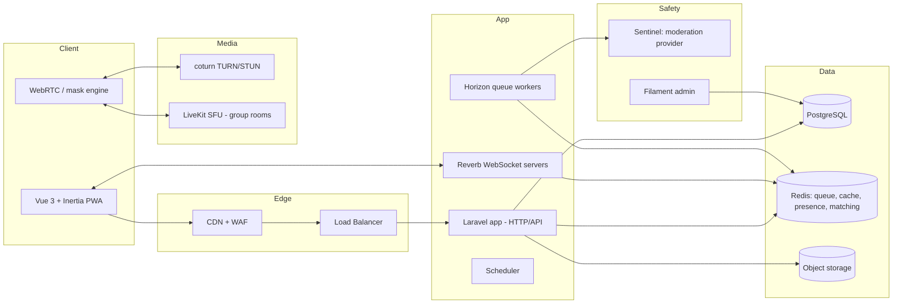

# Emiringkay: Architecture

## 1. High-level diagram



## 2. Architectural style
Modular monolith in Laravel. Domains are separated by folder and service boundaries so they can be extracted later.

```
app/
  Domain/
    Accounts/      Users, verification, trust score
    Matching/      Queue, pairing, filters
    Rooms/         Sessions, messages, signaling, activities
    Connections/   Keeps, friends, rivals, DMs
    Plaza/         Group rooms, events, prompts
    Moderation/    Reports, Sentinel, sanctions, appeals
    Notifications/
  Http/            Controllers, requests, resources
  Policies/
  Jobs/ Events/ Listeners/
resources/js/      Vue 3 + Inertia pages, composables (useRoom, useWebRTC)
```

## 3. Realtime and signaling
- **Laravel Reverb** with Echo: private channels `room.{id}`, presence channel `plaza.{id}`, user channel `user.{id}`.
- Events: `MatchFound`, `SignalOffer`, `SignalAnswer`, `IceCandidate`, `RoomEnded`, `KeepRequested`, `ActivityStarted`, `ReactionSent`.
- Signaling messages are relayed by Laravel (whisper events for low latency), never persisted.

### Call setup sequence
1. Both users get `MatchFound` with a `room_id` and ICE server credentials (short-lived TURN tokens).
2. Initiator creates the RTCPeerConnection and sends the offer via `room.{id}`.
3. Peer answers; ICE candidates exchange.
4. Media flows P2P (or via TURN). The server never touches media.
5. On end, `RoomEnded` is broadcast, the Room closes, and both return to the queue or Keep flow.

## 4. Matchmaking design
- Redis sorted sets per pool: `queue:{pool}:{vibe}:{lang}`, score = join timestamp.
- A worker (or atomic Lua script) pops compatible pairs; compatibility weighs interest overlap, Vibe, language, trust tier.
- Exclusion lists in Redis sets (`skips:{user}`, `blocks:{user}`) are checked during pairing.
- Wait-time relaxation: filters loosen progressively after 5 s, 10 s, 20 s.
- A distributed lock prevents double matching.

## 5. Data model (core tables)

| Table | Key columns |
|---|---|
| users | id, display_name, email/phone, birthdate_confirmed, verified_at, trust_score, status |
| profiles | user_id, avatar, bio, languages, interests (json) |
| rooms | id, type (text/video), vibe, started_at, ended_at, end_reason |
| room_participants | room_id, user_id, joined_at, left_at, skipped |
| messages | id, room_id, user_id, body, created_at (auto-purged) |
| connections | id, user_a, user_b, type (friend/rival/spark/confidant), status, created_at |
| direct_messages | id, connection_id, sender_id, body, read_at |
| plaza_rooms | id, topic, host_id, capacity, starts_at |
| activities | id, room_id, kind (doodle/trivia/breathing/music), state (json) |
| reports | id, room_id, reporter_id, reported_id, category, note, status, severity |
| sanctions | id, user_id, type, reason, expires_at, appeal_status |
| devices | id, user_id, fingerprint_hash, banned |
| badges / user_badges | gamification |
| audit_logs | actor, action, subject, metadata |

## 6. Moderation pipeline (Sentinel)
1. Client samples a frame every few seconds (low-res, on-device pre-check where possible).
2. Frame is sent to the moderation provider via a queued job; nothing is stored unless flagged.
3. Score above threshold: Room ends instantly, user is flagged, evidence frame saved for review.
4. Text messages run through a profanity and harassment classifier plus keyword rules.
5. Flagged items appear in the Filament moderator queue ranked by severity.
6. Moderator actions update Trust Score, sanctions, and device bans, all audit-logged.

## 7. API and auth
- Web: session auth via Laravel Fortify/Breeze; Socialite for Google; phone OTP via SMS provider.
- API (future mobile): Sanctum tokens, versioned `/api/v1`, API Resources, rate limiting per user and IP.
- Authorization through Policies and Gates; roles: user, host, moderator, admin.

## 8. Scalability plan
- Stage 1: single region, 1 app server, 1 Reverb server, managed Postgres/Redis.
- Stage 2: Reverb horizontal scaling with Redis pub/sub, multiple app instances behind a load balancer.
- Stage 3: split matching into its own service, multi-region TURN, read replicas, group rooms on LiveKit cluster.

## 9. Key decisions (ADRs)
| # | Decision | Reason |
|---|---|---|
| 1 | Modular monolith | Speed and simplicity for a small team |
| 2 | Reverb over third-party WebSockets | First-party, free, scales with Redis |
| 3 | P2P WebRTC for 1:1, SFU for groups | Lowest cost and latency for pairs |
| 4 | No media storage | Privacy and legal risk reduction |
| 5 | PostgreSQL | JSON support, reliability, strong tooling |
| 6 | PWA first | One codebase, fastest path to users |
| 7 | Moderation as a first-class domain | Safety is the product's survival factor |

## 10. Testing strategy
- Pest unit and feature tests for every domain.
- Event and broadcast tests with `Event::fake()` and channel authorization tests.
- Browser tests (Dusk or Playwright) for matching and Room flow with fake media devices.
- Load tests (k6) for matching and WebSocket concurrency.
